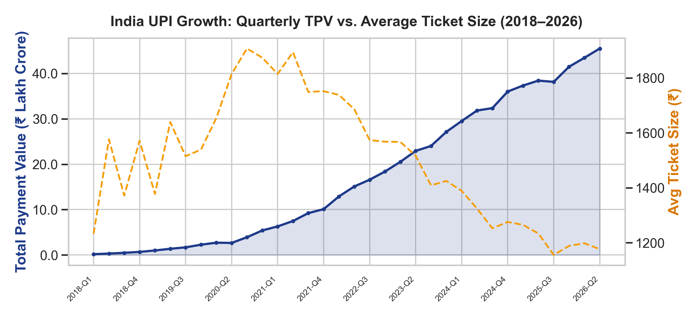
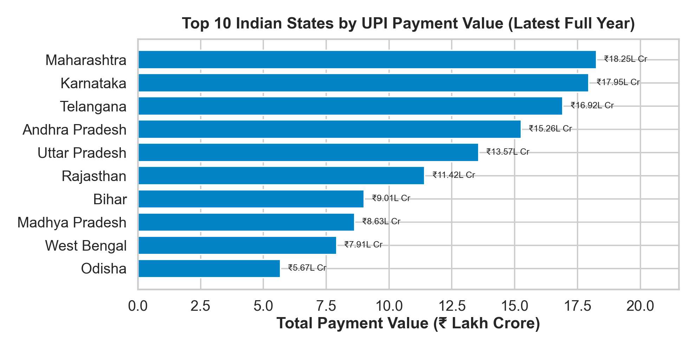
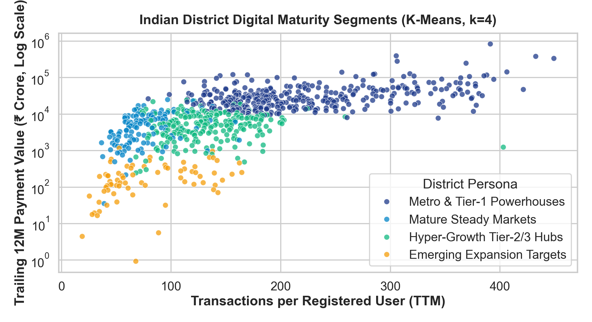
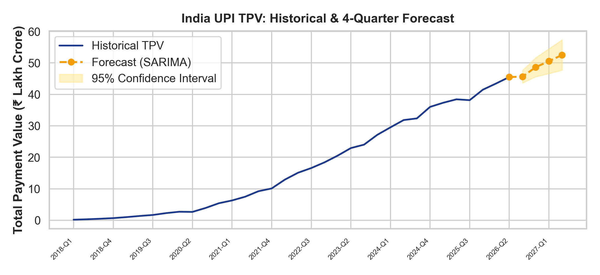

# India UPI & Digital Payments Analysis (PhonePe Pulse)

Analysis, segmentation, anomaly detection, and quarterly TPV forecasting on real **PhonePe Pulse** UPI transaction data (`2018-Q1` to `2026-Q2`) covering **36 States/UTs** and **783 Districts**.

---

## Project Goals

1. **UPI Growth & Category Mix:** Track quarterly Total Payment Value (TPV), average ticket size, and shifts between P2P, Retail/Merchant, and Utility payments.
2. **District Segmentation:** Group India's 783 districts by trailing-12-month payment volume, transactions per user, ticket size, and YoY growth to identify high-growth Tier-2/3 markets.
3. **TPV Forecasting:** Benchmark five time-series models using 6-quarter walk-forward cross-validation and forecast national and top-10 state TPV for the next 4 quarters.
4. **Anomaly Detection:** Flag abnormal state-level quarterly surges and drops using Isolation Forest and peer Z-scores.

---

## Pipeline Architecture

```text
PhonePe/pulse (Raw JSONs: 2018-2026)
        |
        v
  [src/etl.py] --> Star Schema CSVs + SQLite Warehouse (data/processed/pulse_fintech.db)
        |
        +--> [src/sql_analytics.py]      (Window Functions: YoY/QoQ Growth, State Share)
        +--> [src/clustering.py]         (K-Means vs. GMM across 783 Districts)
        +--> [src/anomaly_detection.py]  (Isolation Forest + Peer Z-Score Alerts)
        +--> [src/forecasting.py]        (5-Model Walk-Forward CV + 4Q Forecast)
                |
                +--> [app.py]            (Streamlit Web App)
                +--> [power_bi/]         (Star Schema, DAX Measures, Build Guide)
```

---

## Key Findings

### 1. National UPI Growth & Ticket Size


### 2. Top 10 States by Total Payment Value


* **Top 5 States (2025):** Maharashtra (`11.75%` national TPV share, ₹1,082 avg ticket), Karnataka (`11.55%`), Telangana (`10.89%`), Andhra Pradesh (`9.82%`), and Uttar Pradesh (`8.73%`).

### 3. District Segments (K-Means, k=4)


* **783 districts** segmented using TTM TPV, transactions per registered user, average ticket size, registered users, and YoY TPV growth:
  * **Metro & Tier-1 Powerhouses:** Highest payment volume and transaction frequency per user.
  * **Hyper-Growth Tier-2/3 Hubs:** Fastest YoY TPV growth; strong candidates for merchant QR and credit expansion.
  * **Mature Steady Markets:** Higher ticket sizes with steady growth.
  * **Emerging Expansion Targets:** Lower digital penetration; candidates for user onboarding campaigns.

### 4. TPV Forecasting Benchmark (6-Quarter Walk-Forward CV)


| Model | RMSE (₹ Cr) | MAE (₹ Cr) | MAPE (%) | sMAPE (%) |
| :--- | :---: | :---: | :---: | :---: |
| **SARIMA `(1,1,1)(1,0,0,4)`** | **97,345.77** | **93,261.18** | **2.31%** | **2.30%** |
| Holt-Winters Exponential Smoothing | 101,338.12 | 99,003.36 | 2.45% | 2.45% |
| XGBoost (Lag & Calendar Features) | 279,773.13 | 226,602.87 | 5.40% | 5.62% |
| Prophet (Multiplicative Seasonality) | 875,393.66 | 550,469.81 | 14.43% | 18.08% |
| Seasonal Naive (Baseline) | 652,443.81 | 647,592.48 | 16.01% | 17.45% |

Seasonal `SARIMA` reduces MAPE from `16.01%` (Seasonal Naive baseline) to `2.31%`.

---

## Setup & Usage

```bash
# 1. Install dependencies
pip install -r requirements.txt

# 2. Clone PhonePe Pulse data (if not already present)
git clone --depth 1 https://github.com/PhonePe/pulse.git data/raw/pulse

# 3. Run the full pipeline (ETL -> SQLite -> Clustering -> Anomaly Detection -> Forecasting -> Charts)
python run_pipeline.py

# 4. Run tests
pytest -v

# 5. Launch the Streamlit dashboard
streamlit run app.py
```

---

## Repository Structure

* `src/` — ETL, SQL analytics, clustering, anomaly detection, forecasting, and chart generation scripts.
* `notebooks/` — Jupyter notebooks for EDA, clustering, and forecasting evaluation.
* `power_bi/` — Star Schema, DAX measures, theme JSON, and step-by-step Power BI build guide.
* `tests/` — `pytest` checks for processed tables, schema integrity, and forecast bounds.
* `app.py` — Streamlit interactive dashboard.
